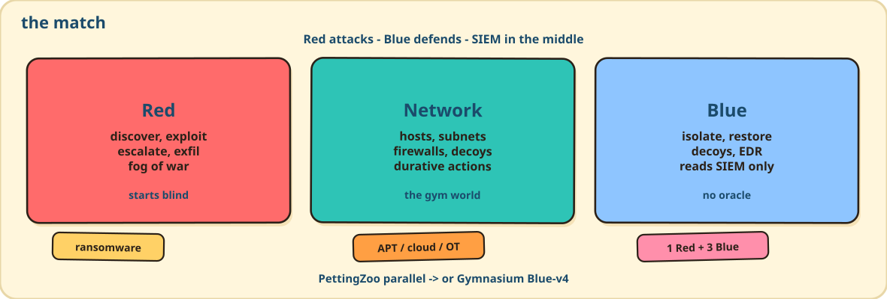

<div align="center">


# NetForge

**A reinforcement learning environment for multi-agent cyber defense and realistic SOC operations.**

PettingZoo (1 Red vs. 3 Blue) · Gymnasium (Single-Agent Blue) · Python 3.12+

[Documentation](https://reforcemind.github.io/NetForge_RL/) · [Quickstart](https://reforcemind.github.io/NetForge_RL/getting-started.html) · [Cyber Mechanics](https://reforcemind.github.io/NetForge_RL/cybersec/overview.html) · [Contributing](CONTRIBUTING.md)

<p align="center">
  
</p>
</div>

---

## Overview

NetForge is a cybersecurity reinforcement learning gym designed around real-world Security Operations Center (SOC) constraints. Rather than providing defenders with ground-truth oracle knowledge or instantaneous actions, NetForge models an asymmetric environment where:

- **Asymmetric Observation**: Red operates under fog of war; Blue observes noisy, delayed Sysmon-like telemetry and constructs belief-state graphs rather than viewing the true compromise map.
- **Durative Actions**: Exploits and defensive remediations require multi-tick execution windows, modeling realistic action latencies and preemption.
- **SLA & False Positive Constraints**: Defenders must maintain network uptime and service availability; blindly isolating hosts degrades SLA scores.
- **Multi-Agent & Single-Agent APIs**: Supports PettingZoo for tiered multi-agent defense (`blue_dmz`, `blue_internal`, `blue_restricted` vs. `red_operator`) and Gymnasium for single-agent benchmarking.

## Comparison

| Feature | CybORG / CAGE | CyberBattleSim | Yawning Titan | NetForge |
|---|---|---|---|---|
| **Defender View** | Host state table (near-oracle) | Attack graph | Abstract graph nodes | **SIEM event buffer + belief graph** |
| **Action Latency** | Instant / mixed | Instantaneous | Instantaneous | **Durative (multi-tick execution)** |
| **Defensive Penalty** | Reward penalty | N/A | Heuristic cost | **SLA uptime & false positive tracking** |
| **API Standards** | Custom wrapper | Gymnasium | Gymnasium | **PettingZoo (MARL) + Gymnasium** |
| **Telemetry Delay** | None | None | None | **Configurable network & SIEM latency** |

## Quickstart

### Installation

```bash
git clone https://github.com/reforcemind/NetForge_RL.git
cd NetForge_RL
pip install -e .
```

To install development dependencies:

```bash
pip install -e ".[dev,docs]"
```

### Python API

#### Gymnasium (Single-Agent Blue)

```python
import gymnasium as gym
import netforge_rl

env = gym.make("NetForge/Blue-v4", max_ticks=100)
obs, info = env.reset(seed=42)

for _ in range(100):
    # Action: [action_type, target_host_index]
    action = env.action_space.sample(mask=info.get("action_mask"))
    obs, reward, terminated, truncated, info = env.step(action)
    if terminated or truncated:
        break

env.close()
```

#### PettingZoo (Multi-Agent Parallel)

```python
import netforge_rl
from pettingzoo import make

env = make("parallel", "netforge/ransomware-v4", max_ticks=100)
obs, infos = env.reset(seed=42)

while env.agents:
    actions = {
        agent: env.action_space(agent).sample(mask=infos[agent].get("action_mask"))
        for agent in env.agents
    }
    obs, rewards, terminations, truncations, infos = env.step(actions)

env.close()
```

### Command Line Interface

```bash
# Run a scenario pack and generate an HTML timeline replay
netforge run hospital_ransomware --replay replay.html

# Evaluate an agent policy
netforge evaluate examples/submissions/heuristic_blue.py --seeds 0 1 --max-ticks 40

# Run benchmark suites across test splits
netforge benchmark --split dev --seeds 0 1 --max-ticks 40
```

## Scenario Packs

NetForge includes ready-to-run scenarios covering common attack methodologies:

- `hospital_ransomware`: Fast-spreading encryption targeting clinical workstations and database servers.
- `enterprise_apt`: Stealthy reconnaissance, credential harvesting, and domain escalation.
- `cloud_iam`: Cloud-native attacks targeting IAM misconfigurations and serverless roles.
- `iot_fleet`: Large-scale compromised perimeter devices pivoting into internal networks.
- `ot_plant`: Industrial control system sabotage targeting simulated PLC physical dynamics.
- `zero_trust`: Identity token attacks (Pass-the-Hash / Pass-the-Ticket) against ticket rotation defenses.

Custom topologies and reward functions can be authored via scenario YAML files or Python classes.

## Specification Summary

| Component | Specification |
|---|---|
| **Agents** | `red_operator`, `blue_dmz`, `blue_internal`, `blue_restricted` |
| **Action Space** | `MultiDiscrete([32, 100])` (Action Code $\times$ Target Host) |
| **Observation Space** | Host vector (256-d), SIEM embeddings (128-d), Action Mask (132-d), Adjacency matrix |
| **Belief Graph** | Available via `GraphObservationWrapper` as PyTorch Geometric-ready graph dict |
| **Evaluation Metrics** | SLA Uptime, Mean Time to Containment (MTTC), False Positives, Data Exfiltration |

## Citation

```bibtex
@misc{jankowski2026netforgerlmultiagentsimulation,
      title={NetForge RL: A Multi-Agent Simulation Environment for Cyber Defense with Durative Actions},
      author={Igor Jankowski},
      year={2026},
      eprint={2604.09523},
      archivePrefix={arXiv},
      primaryClass={cs.LG},
      url={https://arxiv.org/abs/2604.09523},
}
```

## License

This project is licensed under the MIT License. See [LICENSE](LICENSE) for details and third-party notices.
