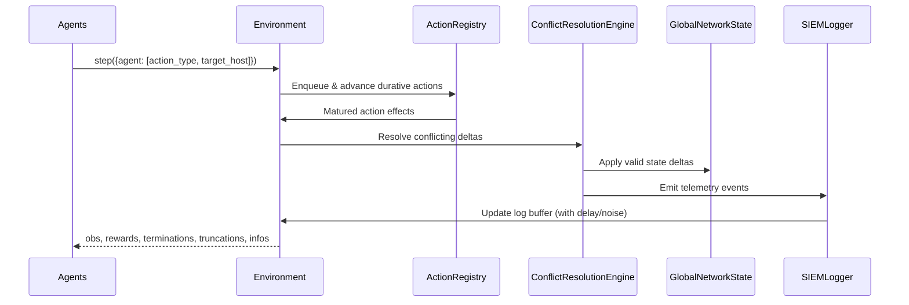
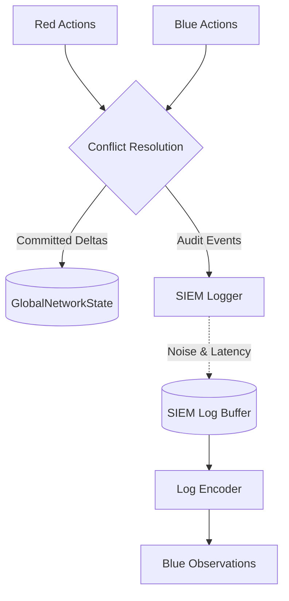

# Simulation Architecture

NetForge runs a deterministic tick loop coordinating agent decision-making, durative action queues, conflict resolution, physical simulations, and telemetry generation.

## Tick Execution Lifecycle

Each environment step proceeds through structured execution phases:

1. **Action Ingestion & Validation**: Agents submit discrete action pairs `[action_type, target_host]`. The environment validates the move against the legal action mask.
2. **Durative Queueing**: If an action requires multiple ticks to complete (e.g., service scanning, payload transfer), it is placed in the agent's action queue. An agent remains locked until its active action matures.
3. **Conflict Resolution**: When opposing actions mature on the same tick (e.g., an adversary attempting `ExploitRemoteService` while Blue issues `IsolateHost` on the same host), the `ConflictResolutionEngine` evaluates precedence rules. Defensive isolations take precedence and cancel pending exploits.
4. **State Commit**: Valid state deltas (compromise flags, privilege tiers, online status) are applied to `GlobalNetworkState`.
5. **Physical Process Simulation**: If OT/SCADA devices are present, their continuous physical equations (pressure, temperature) are updated.
6. **Telemetry & Log Buffering**: Actions that emit observable signatures generate Sysmon-formatted event records. These events enter the SIEM log buffer subject to network drop rates and arrival latencies.
7. **Observation Construction**: Blue observations are synthesized from the SIEM log buffer and known asset inventory, ensuring defenders never inspect privileged simulator state.

## Observability Pipeline

